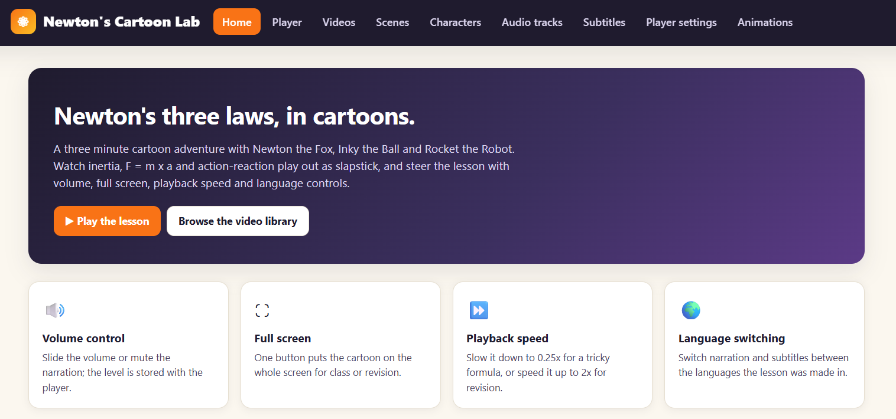
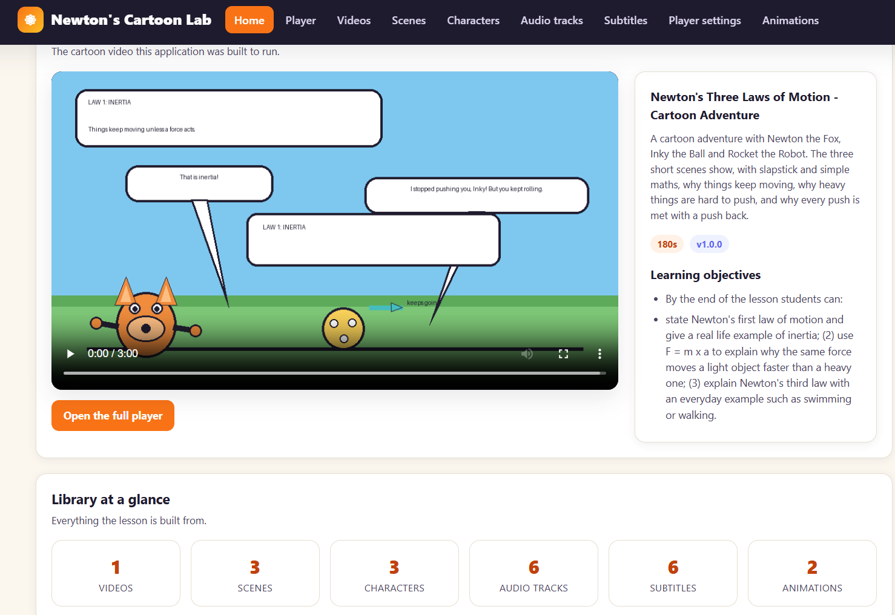
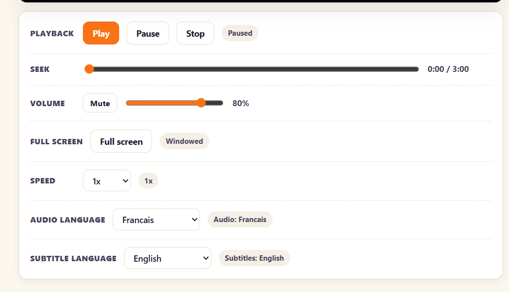
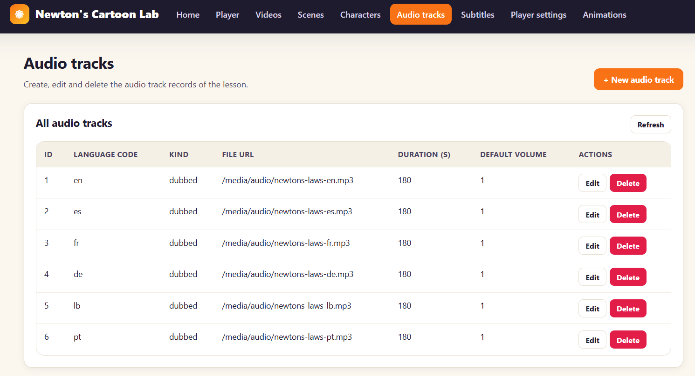

# Newton's Cartoon Lab

A web app that plays a three-minute cartoon lesson teaching **Newton's three laws of motion** to secondary school students. Newton the Fox, Inky the Ball and Rocket the Robot act out inertia, F = m × a and action-reaction. The viewer controls the lesson with volume, full screen, playback speed, and a choice of narration and subtitle languages.

It is a FastAPI backend (`backend/`) and a React + Vite frontend (`frontend/`).

## Contents

- [Top navigation](#top-navigation)
- [Home](#home)
- [Player](#player)
- [Data pages: videos, scenes, characters, audio tracks, subtitles, player settings, animations](#data-pages)
- [Run it](#run-it)

## Top navigation

The header is on every page. The brand link ("Newton's Cartoon Lab") returns to Home, and the highlighted item shows the current page:

**Home · Player · Videos · Scenes · Characters · Audio tracks · Subtitles · Player settings · Animations**

## Home



The landing page introduces the lesson.

| Element | What it does |
| --- | --- |
| **▶ Play the lesson** | Opens the full Player. |
| **Browse the video library** | Opens the Videos list. |
| **Feature cards** | Short descriptions of the four player controls: **Volume control** (slide or mute; the level is stored with the player), **Full screen**, **Playback speed** (0.25x to 2x) and **Language switching** (narration and subtitles). |



Further down the Home page:

| Element | What it does |
| --- | --- |
| **The lesson** | A preview video player with the lesson title, description, duration tag (for example 180s), version tag and the **Learning objectives**. |
| **Open the full player** | Opens the Player page for the full set of controls. |
| **Library at a glance** | Counters for the number of videos, scenes, characters, audio tracks, subtitles and animations in the library. |

## Player



The Player page shows the lesson title, the video, a control panel and a side column. If more than one video exists, a **Video** drop-down at the top lets you load another one.

| Control | What it does |
| --- | --- |
| **Play / Pause / Stop** | Starts, pauses, or stops the lesson and rewinds it to the start. A pill next to the buttons shows **Playing** or **Paused**. |
| **Seek** | A slider to jump to any second of the lesson, with a readout such as `0:00 / 3:00`. |
| **Volume** | A **Mute / Unmute** button and a volume slider with a percentage readout. |
| **Full screen** | Switches the video frame to full screen and back. A pill shows **Windowed** or **Full screen on**. |
| **Speed** | Playback speed: 0.25x, 0.5x, 0.75x, 1x, 1.25x, 1.5x or 2x. |
| **Audio language** | Chooses the narration language: English, Spanish, French, German, Luxembourgish or Portuguese. A pill shows the active audio language. |
| **Subtitle language** | Chooses the subtitle language, independently of the audio language. A pill shows the active subtitles. |

How it behaves:

- The cartoon video file itself is silent. The narration is a separate audio track that is played in sync with the picture, and it follows the volume, mute, speed and seek controls.
- Changing the audio language restarts the narration in the new language from the current position.
- Each action is also sent to the backend, which stores the player state (volume, mute, speed, full screen, language, position), so it is remembered between visits.
- Messages appear above the player when something fails or when the browser blocks autoplay. In that case, press Play again.

The side column of the Player page has three cards:

- **About this lesson:** description, learning objectives, and tags for duration, version and active language.
- **Scenes:** the three laws scene by scene, with start and end times and storyboard notes.
- **Cast:** the cartoon characters with their picture and role.

## Data pages

The other pages in the navigation manage the records behind the lesson: **Videos, Scenes, Characters, Audio tracks, Subtitles, Player settings** and **Animations**. They all work the same way.



The **Audio tracks** page, as an example, lists each narration track with its language code (`en`, `es`, `fr`, `de`, `lb`, `pt`), kind (dubbed), file URL, duration and default volume.

| Element | What it does |
| --- | --- |
| **+ New …** (top right) | Opens an empty form in a card **above the table** (not a pop-up window). |
| **Refresh** | Reloads the table from the backend. |
| **Edit** | Opens the same form above the table, filled with that record's values. |
| **Save / Cancel** (in the form) | **Save** creates or updates the record and shows a "created" or "updated" message. **Cancel** closes the form without saving. |
| **Delete** | Deletes the record after a confirmation prompt. |

**About files:** there is no file upload in the app. Fields such as **File URL**, **Thumbnail URL** and **Avatar image URL** are plain text boxes where you type the path or address of a file that is already served by the backend (for example `/media/audio/newtons-laws-en.mp3`).

The form fields of each page:

| Page | Fields |
| --- | --- |
| **Videos** | Title, Description, Duration (s), File URL, Thumbnail URL, Learning objectives, Creation date, Version, and links to Subtitles, Audio tracks, Scenes and Player settings |
| **Scenes** | Title, Sequence index, Start (s), End (s), Storyboard notes, Video, Characters |
| **Characters** | Name, Role, Avatar image URL, Voice actor, Scenes |
| **Audio tracks** | Language code, Kind, File URL, Duration (s), Default volume, Default track, Videos |
| **Subtitles** | Language code, Format, File URL, Enabled by default, Videos |
| **Player settings** | Volume, Full screen, Playback speed, Active language, Muted, Current time (s), Looping, Current video, Active audio track, Active subtitle |
| **Animations** | Animation type, Start (s), End (s), Parameters, Target object id, Scene, Target character |

The "links to …" fields are multi-select lists filled from the existing records. The tables show the first five fields of each record.

## Run it

```bash
docker compose up --build
```

| | |
| --- | --- |
| Web app | http://localhost:3000 |
| API | http://localhost:8000 |
| API docs | http://localhost:8000/docs |

## Run it without Docker

Use two terminals, each starting in this folder.

The API, on http://localhost:8000:

```bash
cd backend
pip install -r requirements.txt
python main_api.py
```

The web app, on http://localhost:5173:

```bash
cd frontend
npm install
npm run dev
```

## Using another API port

The web app reads the API address from `VITE_API_URL` and falls back to
`http://localhost:8000`. If port 8000 is taken, start the API with
`python -m uvicorn main_api:app --port 8080` instead, and create
`frontend/.env.local` holding:

```
VITE_API_URL=http://localhost:8080
```

Then restart `npm run dev`. Vite inlines `VITE_*` at build time, so a
production image needs it as a build argument - `docker-compose.yml` already
passes it that way.

<!-- Run instructions written by BESSER and rewritten on each generation. Delete this line to keep your own edits. -->

<!-- besser:begin -->
---

[](https://github.com/BESSER-PEARL/BESSER)

Generated by [BESSER](https://github.com/BESSER-PEARL/BESSER), the open-source low-code, model-driven platform, from the B-UML model in [`buml/`](buml/).

[Open the model in the BESSER editor](https://editor.besser-pearl.org/?buml=https://github.com/natarajan-chidambaram/teachusingaivideo/blob/main/buml/domain_model.py) · [More apps built with BESSER](https://github.com/BESSER-PEARL/Built-with-BESSER) · [Generation details](BESSER_GENERATION.md)
<!-- besser:end -->
